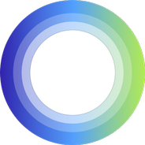

# Mac Assistive Touch 

<p align="center">
  
</p>

<p align="center">
  <b>A lightweight, native floating productivity companion and application launcher for macOS.</b>
</p>

<p align="center">
  
  
  
  
  
</p>

---

## Overview & Motivation

As daily workflows expand and professional tools accumulate, the macOS Dock quickly becomes overcrowded, cluttered, and difficult to manage. Because macOS provides no native way to categorize, group, or organize apps directly within the Dock, users are often left with an overflowing icon strip or forced to navigate through Launchpad and Spotlight for routine tasks.

**Mac Assistive Touch** was created to solve this limitation and bring organized efficiency back to macOS:
- **Unlimited Categorized Apps:** Group and organize as many applications and web links as you need into custom workflows (such as Development, Productivity, Utilities, and Design), overcoming the physical constraints of the Dock.
- **A Cleaner, Distraction-Free Desktop:** Free your macOS Dock from endless icons while keeping all your mission-critical tools instantly accessible inside an elegant, floating glass companion.
- **Always Accessible, Never in the Way:** A subtle floating orb that rests along your screen edge with intelligent auto-docking (**Hide & Peek**), ready to open with a single click or keyboard shortcut without stealing active window focus.

---

## Key Features

- **Floating Glass Orb:** Smooth drag-and-drop placement, magnetized screen edge snapping, customizable idle opacity, and an intelligent **Hide & Peek** auto-docking mechanism.
- **Categorized App Launcher:** Group applications and web bookmarks by workflow (e.g., Development, Productivity, Utilities) with real-time drag-and-drop reordering.
- **Spotlight-Style Quick Search:** Search and filter your apps instantly by pressing `⌘F` or typing directly when the hub is open.
- **System Telemetry:** Real-time monitoring of CPU load, RAM utilization, and battery state with near-zero overhead.
- **Productivity Utilities:**
  - **Quick Scratchpad:** Transient note-taking dock for quick code snippets, ideas, and phone numbers.
  - **Clipboard History:** Fast access to recently copied items for single-click reuse.
  - **Quick Actions:** Single-click screen lock, screenshot capture, audio mute, and trash management.
- **Settings Studio:** Comprehensive 3-column configuration suite to customize categories, gestures, behavior, and visual themes.
- **Bilingual Interface:** Instant runtime switching between **English** and **Turkish**.

---

## Gestures & Shortcuts

| Action | Mouse Gesture | Keyboard Shortcut |
| :--- | :--- | :--- |
| **Toggle Menu Panel** | Left Click on Orb | `⌥ Option + Space` |
| **Take Screenshot** | Double Click on Orb | — |
| **Lock Screen** | Long Press on Orb | — |
| **Reposition Orb** | Drag anywhere on screen | — |
| **Hide & Peek** | Dock to screen edge (hover to expand) | — |
| **Search Apps** | — | `⌘F` (within panel) |
| **Dismiss Hub** | Click outside or `Esc` | `Esc` |

---

## Technology Stack

Mac Assistive Touch is engineered from the ground up with pure native macOS frameworks, ensuring zero third-party dependencies and a minimal resource footprint:

- **Language & Frameworks:** Swift 5.9+, SwiftUI, and AppKit (`NSPanel`, `NSStatusItem`).
- **Window Management:** Non-activating, floating window level (`.floating`) with smooth key-focus delegation.
- **Visuals:** Native macOS `.ultraThinMaterial` dynamic glass materials with support for Light and Dark modes.
- **Low-Level Telemetry:** Mach Kernel APIs (`host_statistics64`) for direct, battery-efficient system metrics.
- **Persistence:** Local JSON-based atomic storage without background daemons or analytics.

---

## Download & Installation

### Pre-built Release
1. Download the latest `MacAssistiveTouch-v1.1.0.zip` from [**Releases**](https://github.com/abdurrahimicyer/mac_assistive_touch/releases).
2. Unzip and move **MacAssistiveTouch.app** to your `/Applications` directory.
3. Open the app to start using it.

> **Note on macOS Gatekeeper:**  
> Since this is an open-source community release, right-click `MacAssistiveTouch.app` and select **Open** on initial launch, or execute:
> ```bash
> xattr -cr /Applications/MacAssistiveTouch.app
> ```

### Building from Source

```bash
# Clone the repository
git clone https://github.com/abdurrahimicyer/mac_assistive_touch.git
cd mac_assistive_touch

# Build and package the application
chmod +x build_app.sh
./build_app.sh

# Launch
open MacAssistiveTouch.app
```

---

## Author & Support

Developed by **Abdurrahim İçyer** • [Gratonya](https://www.gratonya.com)

- 🌐 Website: [www.abdurrahimicyer.com](https://www.abdurrahimicyer.com)
- 🏢 Company: [www.gratonya.com](https://www.gratonya.com)
- ✉️ Contact: [hello@gratonya.com](mailto:hello@gratonya.com)
- 🐙 GitHub: [@abdurrahimicyer](https://github.com/abdurrahimicyer)

---

## License

This project is licensed under the [MIT License](LICENSE).
